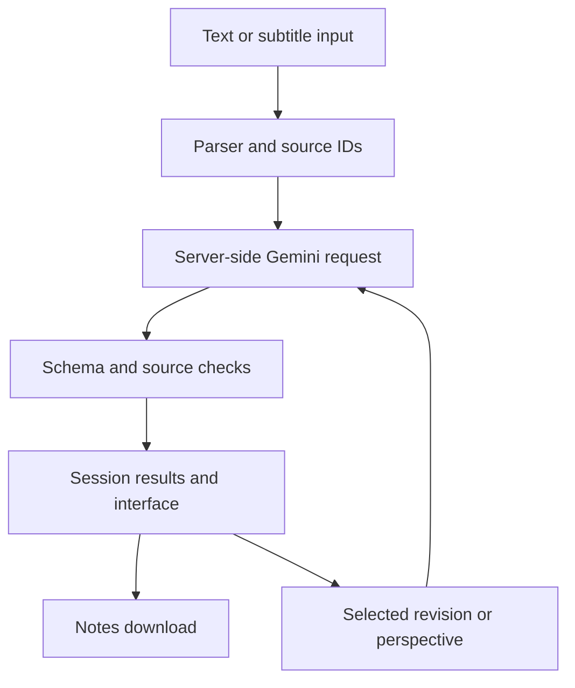

# Bodh — AI Podcast Companion

Bodh helps English- and Bangla-speaking learners turn a podcast transcript into understandable notes, source-linked chapters, critical perspectives and a comprehension quiz. Its distinguishing feature is a Perspective Explorer: it suggests lenses relevant to the episode and accepts a reader's own question or point of view.

**Submission fields — fill these after your own live testing:**

- Live application: TO BE ADDED
- Demonstration video: TO BE ADDED
- Repository: TO BE ADDED
- Live model used and test date: TO BE ADDED
- Manual language/faithfulness findings: TO BE ADDED

**Provider update:** Gemini and Groq adapters are now implemented. If Google denies project access, follow [GROQ_SETUP.md](GROQ_SETUP.md). Groq uses its own authorised account/key and the configured model; there is no automatic provider switch. Groq excerpts are limited to 4,000 spoken-text characters and free-token limits may require smaller input.

Start with [SETUP_GUIDE.md](SETUP_GUIDE.md) for full Windows/VS Code, API, GitHub and hosting instructions. See [SUBMISSION_CHECKLIST.md](SUBMISSION_CHECKLIST.md) before submitting.

## Features and boundaries

- Paste English/Bangla text or upload UTF-8 TXT, SRT or VTT.
- Generate an overview, themes, takeaways and chronological chapters.
- Inspect original source passages next to generated content.
- Preserve subtitle times; plain text gets no invented timestamps.
- Explain or translate an individual chapter on demand.
- Explore suggested/custom perspectives with labelled claims, interpretation and uncertainty.
- Answer up to five questions and receive source-linked feedback.
- Revise only the overview or quiz. Existing results survive failed requests.
- Download Markdown/text notes with source transcript, chapter help, perspectives and answer key; base episode JSON is also available.

Limits: 250 KB UTF-8 file, 16,000 transcript characters, 180 segments/cues. No audio transcription, audio playback, URL scraping, permanent history, web fact-checking or native Chakma support in this release. UI labels are English; output prose can be English or Bangla. Session data may disappear on reconnect/restart.

## Run locally

Use Python 3.12. Windows PowerShell, from this folder:

```powershell
py -3.12 -m venv .venv
.\.venv\Scripts\python.exe -m pip install -r requirements.txt
Copy-Item .streamlit\secrets.toml.example .streamlit\secrets.toml
```

Edit the new secrets file privately with your Gemini API key and an available, free-tier-compatible text model with structured outputs. Then:

```powershell
.\.venv\Scripts\python.exe check_api.py
.\.venv\Scripts\python.exe -m streamlit run app.py
```

On macOS/Linux substitute `.venv/bin/python` for the Windows environment path. Configuration can alternatively come from `GEMINI_API_KEY`, `GEMINI_MODEL` and optional `APP_PASSWORD` environment variables. Environment values take precedence over Streamlit secrets.

## Research and approach comparison

This is a **documentation-based comparison**, not a measured model benchmark. Account access and actual Bangla quality must be tested before submission.

| Criterion | Gemini API (original choice) | Groq-hosted model (implemented option) |
| --- | --- | --- |
| Suitability | Text generation with structured output fits summaries, source-labelled analyses and quizzes | Hosted text generation is an alternative for the same tasks; quality depends on the chosen model |
| Integration | One server-side REST request; JSON schema derived from Pydantic | Implemented REST adapter, JSON Object Mode with schema instructions, local Pydantic/source validation |
| Quality | No Bangla accuracy claim without evaluating outputs against the source | Same evaluation needed; model availability alone does not establish Bangla capability |
| Cost | Free-tier availability varies by model/project; verify before use | Documented free-plan quotas vary by model |
| Latency | Not benchmarked here; UI uses a spinner and request timeout | Not benchmarked here; compare on the same transcript before making speed claims |
| Constraints | Rate limits, response limits, model lifecycle changes and provider data handling | Model-specific request/token quotas and possible output-format differences |

Selected Gemini because its documented JSON-schema output and a direct server request keep the first implementation small. After an actual Google project-access denial, a Groq adapter was added with explicit provider configuration. We avoid automatic fallback calls that could silently change quality, privacy handling or cost.

Sources and what they informed:

1. [Gemini structured outputs](https://ai.google.dev/gemini-api/docs/structured-output): JSON schemas support predictable result structure. Schema correctness is not factual correctness.
2. [Gemini generateContent reference](https://ai.google.dev/api/generate-content): server-side request fields, structured generation and candidate finish reasons.
3. [Gemini pricing](https://ai.google.dev/gemini-api/docs/pricing): free eligibility is model-dependent; data-use policies differ across tiers. Review before uploading material.
4. [Groq rate limits](https://console.groq.com/docs/rate-limits): request/token budgets constrain transcript length and repeated generation.
5. [Streamlit deployment](https://docs.streamlit.io/deploy/streamlit-community-cloud/deploy-your-app) and [secrets](https://docs.streamlit.io/deploy/streamlit-community-cloud/deploy-your-app/secrets-management): GitHub deployment and server-side secret configuration.
6. [MELD](https://data.mendeley.com/datasets/dy5dyfygbp/4) and [ILC-BD](https://data.mendeley.com/datasets/87nx99n8n3/1): relevant to future Chakma evaluation. MELD uses Bengali script; ILC-BD uses Latin transliteration. Neither is integrated, trained on or distributed with this app. They must not be described as powering this release.

Documentation checked during preparation on 12 October 2026. The configured model must be checked against the operator's account before use.

## Architecture



`core.py` defines Pydantic contracts and preserves source segments independently of generated prose. `ai.py` sends the chosen operation and relevant transcript to the explicitly configured provider (AI_PROVIDER), parses the response, rejects incomplete responses and runs validation. `app.py` renders validated objects in Streamlit session state. Chapter help sends only that chapter's passages. Overview/quiz revision sends the transcript and current component, updating only the returned component. Perspective calls are on demand, not part of every render.

The first generation uses one model request. Each perspective, chapter-help request or revision adds one request. A transient 5xx error may cause one retry. Clicking quiz choices, checking answers, opening chapters and downloading results makes no model call.

## Reliability, privacy and security

- Reject empty, binary, oversized, unsupported or malformed input before model calls. No silent transcript truncation.
- Validate JSON types, required fields, quiz option counts and answer indexes.
- Reject unknown/duplicate source references. Check chapters cover every source segment exactly once in order.
- Chapter timestamps come from local cue data, never model-generated times.
- Require source evidence for quiz answers; prompts distinguish speaker claims from independent truth.
- Label interpretation, inferred assumptions and hypothetical examples. Prompt rules reduce risk but do not eliminate hallucinations or prompt injection.
- Model has no tools, external URL fetch capability or access to application secrets in its input. API key is passed only in the request header (x-goog-api-key for Gemini; Bearer authentication for Groq).
- Keys live in server secrets; `.gitignore` excludes local secrets and environments. Provider errors shown to users omit raw request/response details.
- Timeout is 60 seconds per request; transient server errors get one retry. Quota errors/timeouts are not automatically retried. Failed generation/revision preserves prior validated results.
- A per-process 40-request/hour guard and per-session 20-generation guard reduce casual overuse. They reset across processes/sessions and are **not** production-grade distributed protection. An optional review password is supported.
- The app does not intentionally save transcripts to disk or a database. Data is sent to the selected provider (Google Gemini or Groq) for generation; provider retention/data-use terms still apply. Use permitted, non-sensitive transcripts and disclose this processing in the interface.

Source-ID validation proves only that a referenced passage exists. It does not prove semantic entailment, factual truth, natural Bangla or an unbiased interpretation. Inspect source passages and evaluate real outputs.

Groq uses JSON Object Mode rather than provider-enforced JSON-schema constraints in this adapter; local validation still rejects malformed or source-invalid output. See [Groq structured outputs documentation](https://console.groq.com/docs/structured-outputs).

## Tests and debugging evidence

Run:

```powershell
.\.venv\Scripts\python.exe -m unittest discover -s tests -v
```

**Executed during preparation:** 24 automated tests passed on Python 3.12.14, Streamlit 1.65.0 and Pydantic 2.13.5. The tests include parser/encoding/size failures, actual SRT/VTT time preservation, missing chapter coverage, unknown references, invalid quiz answers, malformed/truncated mocked AI responses, timeout handling, 429 handling, bounded 503 retries, request budget and Streamlit UI generation/quiz/revision flows.

**Not executed during preparation:** authenticated Gemini generation, independent Bangla quality review, native Chakma review and public deployment testing. Complete those applicable checks and record results before submission.

### Deliberately tested failure scenario

Failure risk: a model can return valid JSON with a source ID that never existed. JSON parsing alone would accept it, making a misleading evidence link possible.

Investigation: `test_unknown_sources_rejected` substitutes source ID 999 into an otherwise schema-valid episode. `test_chapter_gaps_rejected` supplies chapters covering only the first source passage.

Handling: source validation compares IDs with parsed input and checks exact chronological chapter coverage. Both invalid outputs are rejected. A UI test also simulates a quota error during revision and verifies the previously generated episode remains unchanged. The learning is that structural validity and application-level validity need separate checks. This is a deliberately tested failure, not a claimed production incident.

## Cost and maintenance

Target: $0 for a small reviewer prototype on free hosting and a verified free API tier. Do not enable billing to bypass a quota error. Hosted use consumes the operator's quota even when reviewers generate the content. No exact daily episode count is promised: transcript tokens, output length, model and project limits vary.

Maintain dependency versions, check provider model availability/pricing, review changes in structured-output support, and rerun the tests after updates. Direct dependencies are pinned; transitive dependencies are resolved during installation. Free hosting can sleep/restart, and its capacity is not a production SLA.

## Three next improvements

1. **Human-reviewed Chakma support.** Select script/orthography with users, inspect MELD/ILC-BD licensing and alignment, establish an unseen evaluation set and work with fluent speakers. This tackles language inclusion without mislabelling unverified output as accurate.
2. **Stronger evidence and learning evaluation.** Evaluate semantic support, quiz ambiguity, translation faithfulness and comprehension with users. Add an independent evidence-checking stage only after measuring its benefit. This improves trust and educational value.
3. **Long-episode support with durable controls.** Add chunking, cross-chapter synthesis, background jobs and durable per-user quotas; consider consent-based audio transcription afterwards. This expands coverage without destabilising latency, cost and traceability.

## Ownership and disclosure

The sample transcripts are original illustrative text prepared for this prototype, not recordings or empirical findings. This starter was prepared with AI coding assistance. Review and adapt it, complete live tests, and be able to explain the parser, schemas, provider adapter and session-state revisions. Do not claim that any unperformed evaluation or integration has been completed.

### Encountered provider access issue

The operator reported Gemini HTTP 403 PERMISSION_DENIED with the message “Your project has been denied access. Please contact support.” A separate minimal request confirmed the denial independently of the companion schema. This establishes a project-access problem, not a subtitle or virtual-environment bug. The implementation now supports explicit Groq configuration so a different authorised provider can be used. Google access remains unresolved; operator-authenticated Groq validation is pending. Record your actual test results above.
